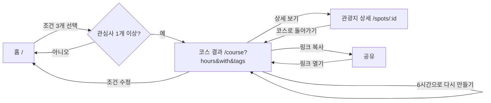

# 사용자 흐름

## 핵심 흐름

## 단계별 설명

| 단계 | 화면 | 사용자 행동 | 시스템 반응 |
|---|---|---|---|
| 1 | 홈 | 여행 시간 · 동행 · 관심사 선택 | 선택 요약과 공유 URL 미리보기 즉시 갱신. 관심사가 없으면 버튼 비활성 + 안내 문구 |
| 2 | 홈 | "코스 만들기" | `/course?hours=4&with=family&tags=nature,experience`로 이동 |
| 3 | 코스 결과 | (자동) | 스켈레톤 표시 → `GET /api/course` 호출 → 타임라인 렌더링 |
| 4 | 코스 결과 | "상세 보기" | `/spots/:id`로 이동. 코스 조건은 `from` 쿼리로 유지해 돌아갈 수 있게 함 |
| 5 | 코스 결과 | "링크 복사" | 현재 URL을 클립보드에 복사, 버튼이 2초간 "복사됨"으로 바뀜 |
| 6 | 코스 결과 | "조건 수정" | 홈으로 이동하며 현재 조건을 폼에 미리 채움 |

## 예외 흐름

| 상황 | 화면 | 처리 |
|---|---|---|
| 조건에 맞는 장소 없음 | 코스 결과 → 빈 결과 상태 | "시간 늘리기", "관심사 더 고르기" 버튼 |
| 잘못된 쿼리 (`hours=99`, 알 수 없는 태그) | 코스 결과 → 400 상태 | 문제가 된 값을 강조하고 "조건 다시 고르기" |
| 없는 장소 id | 관광지 상세 → 404 상태 | "관광지 목록으로", "홈으로" |
| 네트워크 · 서버 오류 | 공통 오류 상태 | "다시 시도" 버튼 |
| 존재하지 않는 경로 | 404 페이지 | 홈으로 |

## URL 설계

| 경로 | 쿼리 | 예 |
|---|---|---|
| `/` | `hours`, `with`, `tags` (선택, 폼 미리 채움) | `/?hours=4&with=family&tags=nature` |
| `/course` | `hours`, `with`, `tags`, `exclude`(P1) | `/course?hours=4&with=family&tags=nature,experience` |
| `/spots/:id` | `from` (돌아갈 코스 쿼리, URL 인코딩) | `/spots/wine-tunnel?from=hours%3D4...` |
| `/spots` (P1) | `tag` | `/spots?tag=photo` |

- `tags`는 쉼표로 구분하고, **태그 정의 순서로 정렬해서** URL을 만든다 → 같은 조건은 항상 같은 URL.
